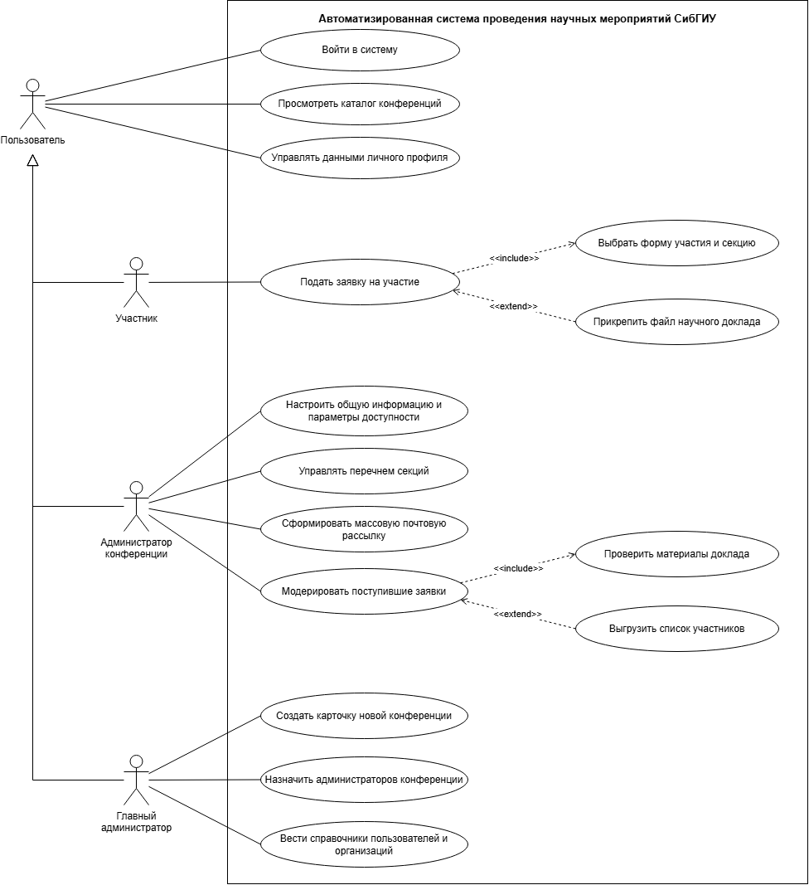
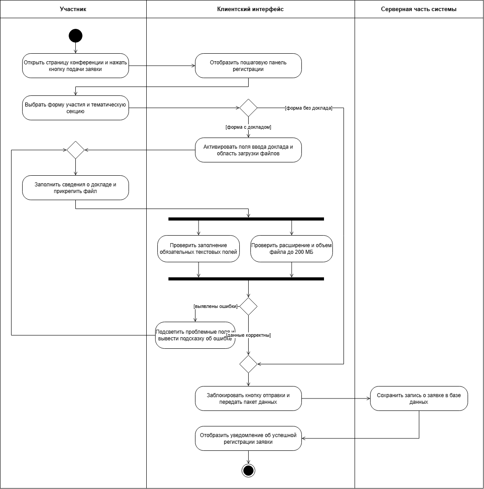
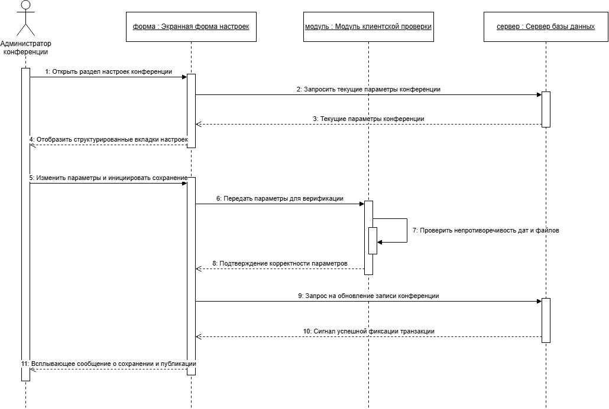
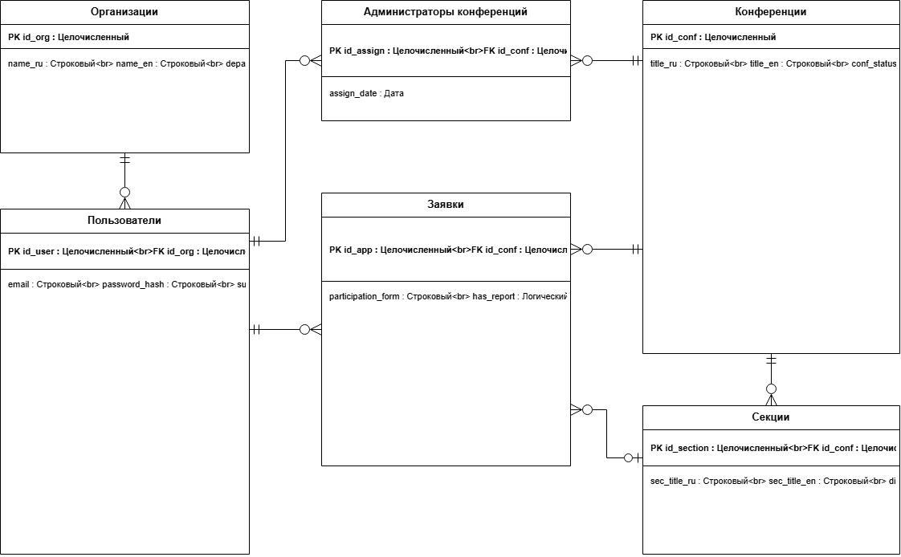
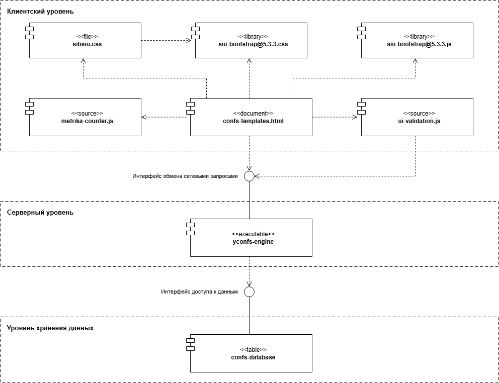

# Модернизация визуального интерфейса ИС проведения научных конференций СибГИУ (Yconfs)

**Какую проблему решает проект:** Данный проект решает проблему устаревшего и неадаптивного визуального интерфейса университетской платформы научных конференций [`confs.sibsiu.ru`](https://confs.sibsiu.ru) (Yconfs). Модернизация обеспечивает корректное отображение системы на мобильных и десктопных устройствах, приводит веб-ресурс к единому корпоративному стилю СибГИУ и упрощает ключевые пользовательские сценарии: подачу заявок участниками, рецензирование докладов и администрирование мероприятий.

---

## Визуализация

### Схема взаимодействия ролей в обновленном интерфейсе
~~~mermaid
graph LR
    A[Гость портала] -->|Авторизация / Регистрация| B(Личный кабинет участника)
    B -->|Подача заявки и статьи| C{Система Yconfs}
    D[Организатор] -->|Управление секциями и рецензирование| C
    E[Администратор УНИ] -->|Модерация, рассылки и экспорт сборников| C
    C -->|Публикация программы| A
~~~

### Диаграммы проектирования и архитектуры системы

Все графические схемы размещены в каталоге [`docs/`](docs/).

#### Диаграмма вариантов использования автоматизированной системы проведения научных мероприятий

*Описание:* Отражает функциональные возможности системы для четырех ролей:
* **Пользователь** — авторизация в системе, просмотр каталога конференций и управление данными личного профиля.
* **Участник** — подача заявки на участие с обязательным выбором формы участия и секции (`<<include>>`), а также прикреплением файла научного доклада (`<<extend>>`).
* **Администратор конференции** — настройка параметров доступности мероприятия, управление секциями, формирование массовых почтовых рассылок, модерация заявок с проверкой материалов доклада и выгрузкой списков участников.
* **Главный администратор** — создание карточек новых конференций, назначение администраторов конференций и ведение справочников пользователей и организаций.

#### Диаграмма деятельности процесса подачи и проверки заявки на участие в конференции

*Описание:* Демонстрирует сквозной алгоритм работы модернизированного интерфейса при подаче заявки (между дорожками **Участник**, **Клиентский интерфейс** и **Серверная часть системы**): отображение пошаговой панели регистрации, динамическая активация полей доклада, параллельная клиентская валидация обязательных текстовых полей и объема файла (до 200 МБ), подсветка ошибок либо сохранение записи в БД с выводом уведомления об успешной регистрации.

#### Диаграмма последовательности процесса настройки параметров конференции в панели управления

*Описание:* Показывает взаимодействие **Администратора конференции**, **Экранной формы настроек**, **Модуля клиентской проверки** и **Сервера базы данных** при запросе текущих параметров, клиентской верификации непротиворечивости дат/файлов и сохранении обновленной записи конференции в БД.

#### Логическая модель базы данных автоматизированной системы проведения научных мероприятий

*Описание:* Структура реляционной базы данных системы включает 6 связанных сущностей: **Организации** (`id_org`), **Пользователи** (`id_user`), **Администраторы конференций** (`id_assign`), **Конференции** (`id_conf`), **Секции** (`id_section`) и **Заявки** (`id_app`).

#### Диаграмма компонентов автоматизированной системы проведения научных мероприятий

*Описание:* Архитектура системы разделена на три уровня:
* **Клиентский уровень (модернизируемая тема `sibsiu`):** таблица корпоративных стилей `sibsiu.css`, библиотеки адаптивной верстки `siu-bootstrap@5.3.3.css` и `siu-bootstrap@5.3.3.js`, шаблоны представлений `confs-templates.html`, модуль клиентской валидации `ui-validation.js` и скрипт аналитики `metrika-counter.js`.
* **Серверный уровень:** исполняемое ядро приложения `yconfs-engine` (PHP / Yii 1.1).
* **Уровень хранения данных:** реляционная база данных `confs-database`.

---

## Основные возможности (Features) и стек технологий

### Ключевые возможности проекта
* **Корпоративный дизайн-код СибГИУ:** специализированная тема оформления `sibsiu` в соответствии с фирменной цветовой палитрой, типографикой и векторной графикой университета.
* **Адаптивная верстка (Responsive UI):** перевод пользовательских макетов на сетку и компоненты **Bootstrap 5.3.3** для удобной работы со смартфонов, планшетов и ПК.
* **Модернизированные пользовательские сценарии:**
  * Личный кабинет участника, профиль автора и пошаговая форма подачи заявок на участие;
  * Рабочее пространство организатора, создание и редактирование конференций;
  * Панель администрирования, рецензирования материалов, рассылок и выгрузки сборников.

### Стек технологий
* **Frontend:** HTML5, CSS3, JavaScript, Bootstrap 5.3.3
* **Backend:** PHP, фреймворк Yii 1.1
* **Инфраструктура:** Docker, Docker Compose, Apache2

---

## Установка (Installation)

Для локального развертывания проекта необходимы установленные **Git** и **Docker** (Docker Compose).

~~~bash
# 1. Клонируйте репозиторий проекта
git clone https://github.com/Ol-Spec/RyazantsevaOA_IVT-23_Project_Work.git

# 2. Перейдите в корневую директорию проекта
cd RyazantsevaOA_IVT-23_Project_Work

# 3. Настройте параметры окружения (.env) и подключения к БД
echo "CONTAINER_NAME=yconfs_app" > .env

# 4. Соберите Docker-образ приложения
docker compose build
~~~

---

## Использование (Usage)

### Запуск базового сценария

~~~bash
# Запуск контейнеров в фоновом режиме с пересборкой образа
docker compose up -d --build
~~~

После запуска веб-интерфейс платформы будет доступен в браузере по адресу: **`http://localhost:8003`**

### Полезные команды и основные параметры (флаги)

~~~bash
# Просмотр логов работы веб-сервера в реальном времени
docker compose logs -f

# Остановка и удаление запущенных контейнеров
docker compose down
~~~

**Объяснение основных параметров и флагов:**
* `-d` (`--detach`) — запуск контейнеров в фоновом режиме (терминал остается свободным).
* `--build` — принудительная пересборка образа перед запуском при изменении конфигурации.
* `-f` (`--follow`) — непрерывный вывод логов контейнера в консоль в реальном времени.
* Порт `8003:80` (в `compose.yml`) — проброс 80-го порта Apache внутри контейнера на локальный порт `8003`.
* Параметр `'theme' => 'sibsiu'` — активирует модернизированную визуальную тему интерфейса.

---

## Структура проекта (Project Structure)

~~~text
RyazantsevaOA_IVT-23_Project_Work/
├── app/                          # Исходный код веб-приложения Yconfs
│   ├── framework/                # Ядро фреймворка Yii 1.1
│   ├── protected/                # Серверная бизнес-логика (MVC: модели, контроллеры)
│   ├── themes/                   # Визуальные темы интерфейса
│   │   └── sibsiu/               # Новая тема в корпоративном стиле СибГИУ
│   │       ├── css/              # Стили темы (sibsiu.css, Bootstrap 5.3.3)
│   │       ├── images/           # Логотипы, баннеры и SVG-иконки
│   │       ├── js/               # Клиентские скрипты и компоненты Bootstrap
│   │       └── views/            # Модернизированные шаблоны страниц (layouts, site, user и др.)
│   └── index.php                 # Входная точка приложения
├── docs/                         # Диаграммы проектирования и архитектуры системы (.png)
├── files/                        # Конфигурации инфраструктуры (Apache2, PHP, скрипты запуска)
├── .editorconfig                 # Единые правила форматирования кода
├── .gitignore                    # Список исключенных временных и конфигурационных файлов
├── compose.yml                   # Описание сервисов для Docker Compose
├── dockerfile                    # Инструкции сборки образа контейнера
├── LICENSE                       # Лицензия проекта (MIT)
└── README.md                     # Документация проекта
~~~

---

## Разработка и вклад (Contributing)

Мы приветствуем предложения по улучшению визуального интерфейса и пользовательского опыта платформы!

### Как сообщить об ошибке (Issue)
1. Перейдите во вкладку **[Issues](https://github.com/Ol-Spec/RyazantsevaOA_IVT-23_Project_Work/issues)** в репозитории.
2. Нажмите кнопку **New Issue**.
3. Опишите проблему: укажите страницу интерфейса, браузер, разрешение экрана и приложите скриншот.

### Как отправить изменения (Pull Request)
1. Сделайте **Fork** репозитория и создайте ветку для вашей задачи:
   ~~~bash
   git checkout -b feature/ui-improvement
   ~~~
2. Внесите изменения в верстку или стили и зафиксируйте их коммитом:
   ~~~bash
   git commit -m "Улучшена адаптивность карточек конференций"
   ~~~
3. Отправьте ветку в свой репозиторий и создайте **Pull Request**:
   ~~~bash
   git push origin feature/ui-improvement
   ~~~

---

## Лицензия (License)

Проект распространяется под лицензией **MIT**. Подробный текст лицензии находится в файле [LICENSE](LICENSE).
